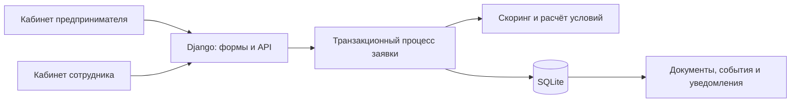

# Alpha — умный кредитный кабинет предпринимателя

**Alpha** объединяет оформление кредитной заявки, проверку компании, оценку риска и принятие предложения в одном кабинете. Предприниматель видит условия и следующий шаг, а сотрудник — документы, финансовые показатели, причины решения и историю обработки.

Проект разработан для Альфа-Хакатона. Вся бизнес-логика выполняется на сервере; для работы не нужны платные API, LLM, CDN или внешние шрифты.

Обычная заявка теперь получает автоматическое одобрение или отказ сразу после отправки по полной скоринговой карте из `docs/reference/mlcard`. Спорные случаи направляются эксперту; ему доступны очередь рассмотрения, вся история заявок и журнал операций. Шаг суммы кредита в формах и калькуляторе — 1 000 ₽. Правила и ограничения описаны в [документации автоматических решений](docs/automatic-decisions.md).

## Возможности

| Предприниматель | Сотрудник |
|---|---|
| Подбор продукта и расчёт платежа | Очередь заявок с поиском и фильтрами |
| Пошаговое оформление и сохранение черновика | Назначение ответственного |
| Профиль компании и загрузка PDF | Проверка документов и финансовых показателей |
| Уведомления и история заявки | Скоринг с PD, факторами риска и причинами решения |
| Сравнение исходных и предложенных условий | Одобрение, снижение суммы, отказ или запрос уточнений |
| Принятие предложения и скачивание графика | Контроль актуальности данных и журнал действий |

Скоринговая карта поддерживает зрелый и молодой бизнес, доход поручителя и залог. Массовый адрес, недостоверные сведения, дисквалификация руководителя и другие стоп-факторы блокируют финансирование. Клиент не может самостоятельно подменить результаты внешних проверок.

## Быстрый запуск через Docker

Понадобятся Git, Docker Engine или Docker Desktop с Compose v2. При первой сборке нужен интернет для загрузки образа и Python-пакетов.

```sh
git clone https://github.com/falvah/alpha.git
cd alpha
docker compose up --build -d
```

Откройте **http://localhost:8000**. Контейнер автоматически применит миграции, соберёт статику и создаст начальную базу.

Проверить состояние и получить учётные записи:

```sh
docker compose ps
docker compose logs --tail=100 cabinet
docker compose exec cabinet cat /app/.data/access.txt
```

| Логин | Роль |
|---|---|
| `entrepreneur` | Предприниматель, основной кабинет |
| `expert` | Кредитный эксперт |
| `client_growth` | Компания с заявкой на развитие |
| `client_young` | Молодой бизнес |
| `client_risk` | Компания с факторами риска |

Пароли генерируются случайно при первом запуске. Общего пароля нет; повторный запуск не сбрасывает учётные записи и решения. База, ключ приложения и файл доступа хранятся в Docker volume `cabinet_data`.

Остановка и повторный запуск с сохранением данных:

```sh
docker compose down
docker compose up -d
```

Не используйте `docker compose down -v`, если нужно сохранить базу: флаг `-v` удаляет volume.

## Локальный запуск без Docker

Нужны Python **3.14**, модуль `venv` и Git. В проекте зафиксирована версия Python 3.14.8. Node.js требуется только для проверок JavaScript.

Для Linux, macOS или WSL:

```sh
git clone https://github.com/falvah/alpha.git
cd alpha
sh scripts/dev.sh
```

Скрипт создаст `.venv`, установит зависимости, применит миграции, соберёт статику, создаст начальные записи и запустит сервер на **http://127.0.0.1:8000**.

Если `python3` указывает на другую версию, сначала создайте окружение явно:

```sh
python3.14 -m venv .venv
sh scripts/dev.sh
```

Учётные записи доступны в файле `.data/access.txt`:

```sh
cat .data/access.txt
```

Для Windows проще использовать Docker Desktop или WSL. Для запуска в PowerShell:

```powershell
git clone https://github.com/falvah/alpha.git
cd alpha
py -3.14 -m venv .venv
.\.venv\Scripts\python.exe -m pip install -r requirements.lock
.\.venv\Scripts\python.exe manage.py migrate --noinput
.\.venv\Scripts\python.exe manage.py collectstatic --noinput
.\.venv\Scripts\python.exe manage.py seed_workspace
.\.venv\Scripts\python.exe manage.py runserver 127.0.0.1:8000
```

Файл доступа в PowerShell: `Get-Content .data\access.txt`. Локальные инструкции для macOS и Windows приведены по структуре проекта; фактическая проверка выполнена на Linux.

## Как проверить основной процесс

1. Войдите как `entrepreneur`, выберите продукт и рассчитайте платёж.
2. Создайте заявку, проверьте сведения компании и загрузите PDF. Для начальной базы подготовлены `fixtures/income-statement.pdf` и `fixtures/guarantee.pdf`.
3. Подтвердите согласие и отправьте заявку.
4. Решение появится сразу. Только для серой зоны или неполных данных войдите как `expert`, откройте очередь рассмотрения, дополните проверки и примите решение.
5. Вернитесь в кабинет предпринимателя, прочитайте решение и примите предложенные условия либо дополните сведения.

В начальной базе уже есть три контрольные заявки из `fixtures/scorecard/`:

| Входные данные | Ожидаемый результат |
|---|---|
| `good_mature.json` — 1 500 000 ₽ на 24 месяца | Полное одобрение |
| `reduced_amount.json` — 10 000 000 ₽ на 36 месяцев | Предложение снизить сумму до **8 310 000 ₽**, с отдельным подтверждением клиента |
| `mass_address.json` — массовый адрес регистрации | Отказ; принятие предложения недоступно |

Они видны предпринимателю в «Моих заявках» и сотруднику во вкладке «Вся история заявок». Для добавления этих записей в существующую локальную базу:

```sh
.venv/bin/python manage.py seed_scorecard --username entrepreneur
```

Повторный запуск команды не создаёт дубликаты. В Docker используйте `docker compose exec cabinet python manage.py seed_scorecard --username entrepreneur`.

Сотрудник может рассчитать JSON в разделе **«Скоринг»** (`/bank/scorecard/`) без изменения заявки либо применить расчёт в её карточке. Сумма, срок и ИНН должны совпадать с отправленной заявкой. После уточнения данных старый скоринг нельзя использовать для одобрения.

## Архитектура и стек



- **Python 3.14 / Django 5.2** — бизнес-логика, ORM, формы, авторизация и шаблоны.
- **SQLite** — хранение заявок, документов и истории; миграции включены в репозиторий.
- **Gunicorn / WhiteNoise** — WSGI-сервер и локальная статика в контейнере.
- **HTML / CSS / JavaScript / SVG** — интерфейс без npm-зависимостей.
- **Decimal / PyYAML** — денежные расчёты и полная скоринговая карта из `docs/reference/mlcard`; [правила и проверенные результаты](docs/scorecard.md).

| Каталог | Содержимое |
|---|---|
| `credit/` | Модели, формы, API, процесс рассмотрения, скоринговая карта |
| `config/` | Настройки Django, маршрутизация и WSGI |
| `templates/`, `static/` | Интерфейс |
| `fixtures/` | Входные данные для начальной базы и тестов |
| `tests/` | Проверки расчётов, доступа, валидации, HTTP и JavaScript |
| `scripts/` | Локальный запуск, запуск контейнера и проверки |
| `docs/` | [Навигация по документации](docs/README.md), архитектура, API и правила скоринга |
| `docs/reference/` | Исходные документы, формат входа и эталон модели |
| `docs/reports/` | Исторические отчёты проверок |
| `.data/`, `.venv/`, `staticfiles/` | Локальная база, окружение и собранная статика; исключены из Git |

## Проверки

После установки локальных зависимостей:

```sh
sh scripts/check.sh
```

Скрипт проверяет зависимости, настройки, миграции и серверные тесты. Если установлен Node.js, дополнительно выполняются проверки JavaScript.

Команды по отдельности:

```sh
.venv/bin/python -m pip check
.venv/bin/python manage.py check
.venv/bin/python manage.py makemigrations --check --dry-run
.venv/bin/python manage.py test tests -v 2
node --test tests/frontend.test.cjs
```

Текущая проверка: **116 серверных тестов и 5 тестов JavaScript**. Они включают сверку с исходным движком, автоматические решения, права доступа и историю. Команды запуска и границы проверок — в [docs/testing.md](docs/testing.md).

## Настройки и данные

Настройки перечислены в `.env.example`. Для Docker можно скопировать его в `.env`: Compose прочитает файл автоматически. При локальном запуске настройки передаются переменными окружения; Django не загружает `.env` самостоятельно.

| Переменная | Назначение |
|---|---|
| `SANDBOX_MODE` | По умолчанию `true`: локальный HTTP и загрузка начальной базы |
| `DEBUG` | По умолчанию `false` |
| `SECRET_KEY` | Ключ приложения; при локальном запуске создаётся автоматически |
| `ALLOWED_HOSTS` | Разрешённые имена хостов |
| `CSRF_TRUSTED_ORIGINS` | Доверенные origins с протоколом |
| `DATA_DIR` | Каталог базы и локальных служебных данных; по умолчанию `.data/` |

Для HTTPS-развёртывания установите `SANDBOX_MODE=false`, отдельный случайный `SECRET_KEY` длиной от 50 символов, точные `ALLOWED_HOSTS` и `CSRF_TRUSTED_ORIGINS`. Прежнее имя `DEMO_MODE` поддерживается для совместимости. Подготовка инфраструктуры описана в [docs/security.md](docs/security.md).

Пароли, база, `.env`, `.venv`, собранная статика и кэши исключены из Git. Не публикуйте содержимое `.data/access.txt`.

## Частые вопросы при запуске

- **Порт 8000 занят.** Для Docker измените проброс в `compose.yaml`, например на `127.0.0.1:8001:8000`, и откройте `http://localhost:8001`.
- **Контейнер ещё не готов.** Проверьте `docker compose ps` и `docker compose logs --tail=100 cabinet`: первый запуск включает миграции и сборку статики.
- **Нет Django или других модулей.** Используйте Python из `.venv`; при необходимости повторите установку `-m pip install -r requirements.lock`.
- **Ошибка Host или CSRF при открытии по домену.** Укажите этот хост и origin в настройках; после изменения переменных пересоздайте контейнер: `docker compose up -d --force-recreate`.
- **Нужно остановить локальный сервер.** Нажмите `Ctrl+C`. Данные останутся в `.data/`.

## Интеграции

Платформа реализует процесс и расчёты. ФНС, БКИ, платёжная система и юридически значимая электронная подпись пока не подключены. Результаты проверки компании передаются сотрудником; принятие условий фиксируется в базе и не переводит реальные деньги. Используется проектная скоринговая политика: исходная банковская карта коэффициентов в материалах не предоставлена.

## Документация

[Архитектура](docs/architecture.md) · [Скоринг](docs/scorecard.md) · [API](docs/api.md) · [OpenAPI](docs/openapi.json) · [HTTP-запросы](docs/requests.http) · [Безопасность](docs/security.md) · [Проверки](docs/testing.md) · [Структура и очистка](docs/project-structure.md)

Лицензии компонентов и сведения об исходных материалах: [THIRD_PARTY_NOTICES](THIRD_PARTY_NOTICES).
