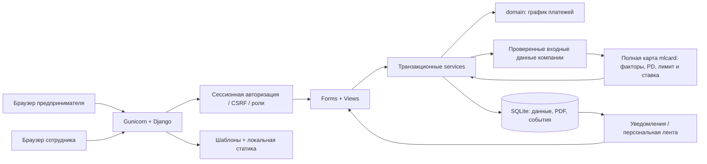
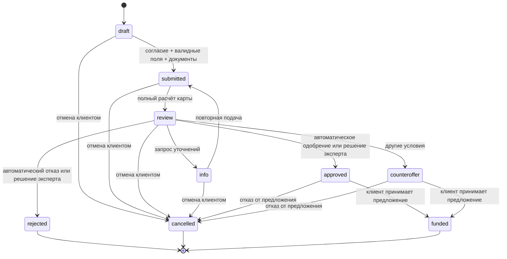
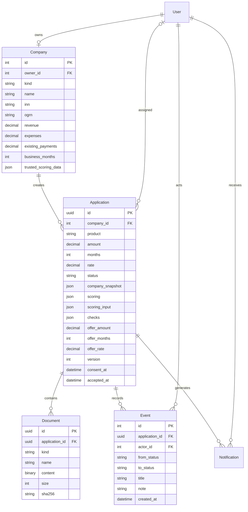

# Архитектура

Модульный монолит с серверной отрисовкой. Для проверяемого MVP он уменьшает число компонентов, поверхность API и риск рассогласования состояния. В браузере нет JWT, секретов и бизнес-решений: JavaScript обслуживает калькулятор, меню и вспомогательные элементы.

- `Company` принадлежит одному пользователю. В MVP нет делегирования доступа нескольким представителям одной компании.
- `Application` содержит параметры кредита, отдельные предложенные условия, версию, ответственного, согласие, оценку и снимок реквизитов/финансов.
- Отправка фиксирует снимок компании, версию правил, результаты проверок и момент согласия. Изменение профиля не меняет отправленные заявки.
- Уточнение даёт возможность исправить данные и снова отправить заявку. Новый снимок фиксируется при повторной отправке. Журнал хранит события и комментарии, но не является полным архивом всех старых финансовых снимков.
- `Event` записывается в той же транзакции, что и статус. Пользовательских операций изменения/удаления журнала нет. Администратор БД технически может его изменить: это не WORM-хранилище.
- PDF хранится как бинарный объект в БД, не как доступный через URL файл. На списках `defer('content')` исключает чтение содержимого. Максимум 25 МБ файлов на заявку; для промышленной нагрузки нужен объектный storage.
- `Notification` — долговечное сообщение внутри кабинета. Новости на главной — локальные материалы, выбранные по возрасту компании, статусам и последнему продукту, а не внешняя новостная интеграция.

## Состояния

Обычная отправка, JSON API и пересчёт экспертом вызывают полный движок `credit/mlcard` из `docs/reference/mlcard`. Серверный источник `Company.trusted_scoring_data` передаёт проверки и показатели документа; клиентская анкета задаёт сумму, срок и цель. Вход сохраняется в `scoring_input`, полный результат — в `scoring`, ревизия/дата/отпечаток источника — в `checks`. `scorecard_workflow` применяет одобрение, встречное предложение, отказ или ручную проверку. Старый условный расчёт удалён. [Правила и происхождение карты](scorecard.md). Принятие и отмена доступны только владельцу. Повторное принятие уже выданной заявки возвращает тот же результат без новой записи о выдаче.

## Модель данных

## Надёжность и границы масштаба

Сервисные изменения обёрнуты в `transaction.atomic()`. В SQLite задан `transaction_mode=IMMEDIATE`: запись резервируется в начале транзакции. Клиент передаёт `version`; устаревшая форма отклоняется. При переходе на PostgreSQL `select_for_update()` обеспечивает блокировку строки, но смену БД и миграцию документов следует проверить нагрузочными и конкурентными тестами.

Синхронные локальные проверки детерминированы и быстры; очереди задач нет. Удалённые БКИ/реестр потребуют timeouts, retry/backoff, idempotency keys и outbox. Горизонтальное масштабирование текущего SQLite-развёртывания не заявляется.

Health endpoint проверяет соединение с БД. Docker содержит healthcheck, сохраняемый volume, непривилегированного пользователя и ограничение ресурсов. Логи Gunicorn доступны в stdout; пароли и тела запросов приложение не пишет.
