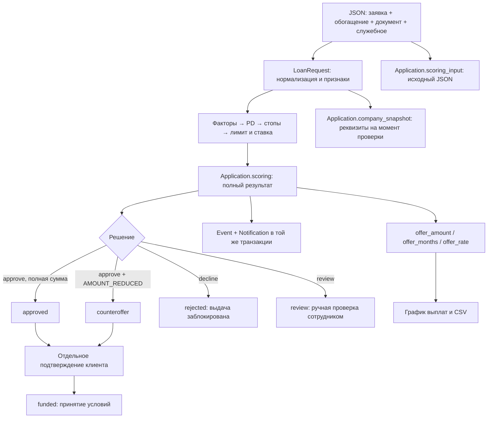

# Скоринговая карта и новые связи

Реализован контракт из `доки/нововедение/Пояснение_к_JSON_и_входным_данным.md`.
Все три исходных JSON без изменений включены в `fixtures/scorecard/` и используются при загрузке начальной базы и в регрессионных тестах.

| Пример | Результат | Условия |
|---|---|---|
| `good_mature.json` | `approved` | 1 500 000 ₽, 24 месяца, 20% |
| `reduced_amount.json` | `counteroffer` | 5 500 000 ₽ вместо 10 000 000 ₽, 36 месяцев, 20% |
| `mass_address.json` | `rejected` | `ADDRESS_MASS`; предложение и выдача недоступны |

В первых двух случаях клиент должен отдельно принять условия. Только после подтверждения заявка переходит в `funded`, создаётся событие принятия условий. Повторное подтверждение не создаёт повторную выдачу. Второй JSON в контракте возвращает `decision=approve` с `AMOUNT_REDUCED`; кабинет переводит именно такое сочетание во встречное предложение `counteroffer`.

## Карта и расчёты

В поставке нет упомянутого `card.yaml`, исходных коэффициентов, порогов PD и полной тарифной сетки. Поэтому реализована отдельная **проектная карта `project-1.0.0`**. Её результаты не выдаются за результаты отсутствующей оригинальной карты. Параметры находятся в `credit/scorecard/policy.py`, факторные диапазоны — в `credit/scorecard/engine.py`. Переданная в примерах версия `1.0.0` сохраняется; отличие от используемой версии отражается флагом `CARD_VERSION_MISMATCH`.

- Нормализация: русские/английские ключи, `да` / `нет` / `пусто`, даты, денежные суммы с пробелами, запятой и обозначением рублей. Некорректные типы, отрицательные показатели, NaN/Infinity, будущая регистрация и две ветки документа одновременно вызывают `InputDataError`.
- Mature определяется заполненными полями документа; нужны `months_with_inflows >= 12` и `avg_monthly_inflow`.
- Young использует годовой доход поручителя / 12 и/или залог. Отсутствие обеих веток даёт `DOCUMENT_MISSING`.
- Обязательное наличие значения `has_history`: `false` допустимо, отсутствие — отказ. Критичные проверки: адрес (массовость, достоверность), руководитель (дисквалификация, массовость), номинальный владелец. Неизвестный результат даёт `CRITICAL_DATA_MISSING`.
- Стопы: массовый/недостоверный адрес, дисквалифицированный/массовый руководитель, более 20 компаний у руководителя, номинальный владелец, просрочка более 90 дней. Они блокируют выдачу независимо от остальных факторов.
- `logit = -2.50 + Σ points`, `pd = sigmoid(logit)`. PD возвращается и при отказе. В этой карте `pd >= 0.20` требует ручной проверки, `pd > 0.30` блокирует, минимальное покрытие факторов — 0.60.
- Mature: бюджет платежа = поступления × 0.8 × 0.30. Лимит — обратная аннуитетная формула по 24% с округлением вниз до 10 000 ₽. Это поступления на счёт, а не прибыль. Сумма одобрения не превышает запрошенную.
- Young: бюджет = годовой доход поручителя / 12 × 0.30 при наличии поручительства. Залоговые LTV: недвижимость 0.7; транспорт/оборудование 0.5; прочее 0.3. Лимит — максимум лимита поручителя и залога (без суммирования двух источников). Минимальная сумма карты 100 000 ₽; при создании заявки дополнительно соблюдается минимум продукта.
- Ставки карты: 20% при PD < 0.05; 22% при PD < 0.10; 24% иначе. Полное покрытие залогом снижает ставку на 1 п.п.; округление — до 0.5 п.п. Деньги рассчитываются через Decimal, платёж — до копеек.

## Связи данных и процесса



Исходный JSON сохраняется в новом поле `Application.scoring_input` (миграция 0003), решение — в существующем `scoring`, проверенные сведения — в `checks`. Никаких изменений пользовательского профиля при создании синтетической заявки нет. В карточке показаны снимок реквизитов, причина решения и предложение; сотруднику доступны PD, покрытие, факторы и флаги. API заявки возвращает `scoring`.

Импортированные данные документа считаются уже извлечёнными показателями. Ссылка `document_url` хранится в исходном JSON, но не загружается. Для контрольных заявок создаётся явно помеченный синтетический PDF; он не выдаётся за оригинал по ссылке. Для реальной заявки сотрудник прикладывает JSON к ранее отправленной заявке с её существующими документами.

В обычной форме без JSON сохраняется существующая рекомендательная модель `rules-v1`. Сотрудник может открыть **Скоринговая карта → Рассчитать решение** в отправленной заявке, передать JSON и применить новую модель. Сумма, срок и ИНН должны совпадать со снимком отправленной заявки. Проверяются роль, назначенный сотрудник и версия. При `review` заявку можно взять на ручную проверку. Решение по новой карте ограничивает и ручное одобрение, и выдачу: стоп нельзя обойти, сумму выше лимита принять нельзя.

Клиентский endpoint `/scenarios/` удалён: клиент не может передавать собственное обогащение и автоматически одобрять себе кредит. Раздел `/bank/scorecard/` доступен только сотруднику. Команды загрузки начальной базы работают только в SANDBOX_MODE; повторный запуск не дублирует записи. После уточнения заявки требуется свежая оценка. Внешние реестры не вызываются.

Тестовый слой `tests/support/fake_enrichment.py` вызывается явно. Он сохраняет `None` для непроведённых проверок и не перезаписывает обогащение. Это существенно: адрес во всех исходных JSON одинаковый, но результаты проверки массовости различаются. При автоматической подмене обогащения все три примера оказались бы заблокированы.

## Запуск

```sh
.venv/bin/python manage.py migrate --noinput
# Создать все рабочие профили и три новых сценария:
.venv/bin/python manage.py seed_workspace
# Либо добавить только сценарии в существующий профиль:
.venv/bin/python manage.py seed_scorecard --username entrepreneur
.venv/bin/python manage.py test tests.test_scorecard tests.test_scorecard_workflow -v 2
```

Войти существующим предпринимателем и открыть `/applications/`. Существующие пароли и заявки не заменяются. В кабинете сотрудника результаты видны в общей очереди.

Отклоняются повторяющиеся JSON-ключи, несколько алиасов одного поля, вложенность более 8 уровней, более 1000 значений, неконечные числа и суммы с долями копейки. Период поступлений не может превышать возраст компании. Размер JSON ограничен 64 КБ. После уточнения `checks.needs_refresh` блокирует одобрение до загрузки свежих проверок.
